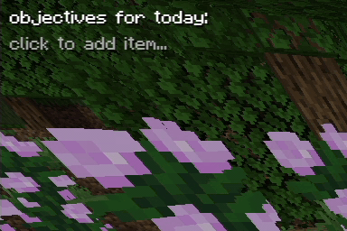

a to-do list for obs that i use for my minecraft videos

## usage

on obs: add source > browser > [x] local file > select index.html

after that you can right click the source and select "interact" to modify the list

## shortcuts

- `enter`: add a new item (if you are currently editing an item)
- `ctrl+enter`: toggle the checkbox of the current item
- `esc`: stop editing an item (removes the cursor)
- `shift+del`: removes item
- `alt+up/down`: move item up or down
